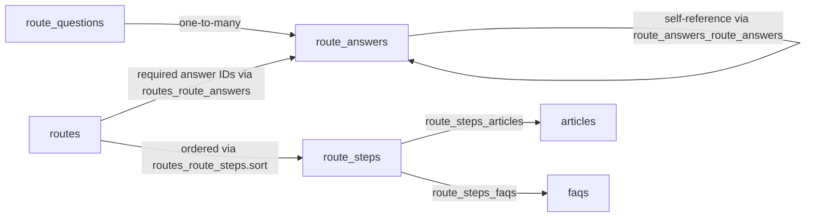
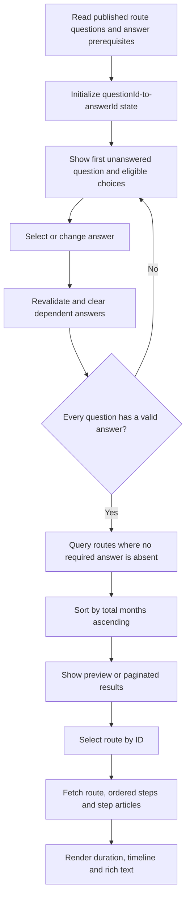

# Routetool flow and matching specification

**Purpose:** Behavioral and data-contract reference for implementing another client against the same Directus data as the Onderwijsloket routetool.  
**Reviewed:** 2026-10-20  
**Source frontend:** [`onderwijsin/onderwijsloket`](https://github.com/onderwijsin/onderwijsloket/tree/3d0468a3873435847ea5ee55ada96a67856b7ebf), `main` at `3d0468a3873435847ea5ee55ada96a67856b7ebf`.  
**Source Directus:** [`onderwijsin/onderwijsloket-directus`](https://github.com/onderwijsin/onderwijsloket-directus/tree/e5c2c15cd7911293484cb02675a4366efd29ee7f), `next` at `e5c2c15cd7911293484cb02675a4366efd29ee7f`.  
**Evidence:** Inspected source code, generated Directus model types, schema snapshots, permissions seed and duration hook. Did not query production Directus records or exercise the live UI. Examples below use invented IDs.

## 1. Executive behavior contract

The tool is a **fixed, ordered, single-select questionnaire with dynamically available answer options**. It is not a decision tree that creates/skips questions. Every question must have one answer before results are shown.

1. Fetch ordered questions and their ordered answer options from Directus.
2. Show a question's answer option only if its prerequisites are satisfied by the current selections. Answers without prerequisites are always available.
3. Disable questions after the first unanswered question; earlier answered questions remain editable.
4. After an answer changes, remove dependent selections that are no longer available.
5. Once all questions have answers, find routes for which **every required answer is in the selected answer set** (subset/AND matching).
6. Sort all matching routes by `duration_in_months` ascending. There is no scoring, weighting, or single best-route calculation.
7. Show the three shortest as a preview, and a paginated full list of all matches.
8. Opening a route shows its timeline of steps, total duration, step content and links to related articles.

**Critical distinction:** The `requires_answers` field exists on **both** `route_answers` (visibility prerequisites for that answer) and `routes` (eligibility requirements for that route). The meaning and boolean logic are different.

## 2. Source data model

| Collection                    | Relevant fields                                                                                                                | Role                                                                                                                                              |
| ----------------------------- | ------------------------------------------------------------------------------------------------------------------------------ | ------------------------------------------------------------------------------------------------------------------------------------------------- |
| `route_questions`             | `id`, `question`, `description`, `sort`, `status`, `answers`                                                                   | Ordered, mandatory prompts. `answers` is a one-to-many relation to `route_answers`.                                                               |
| `route_answers`               | `id`, `question`, `title`, `description`, `sort`, `status`, `requires_answers`                                                 | A single selectable option for one question. `question` refers to `route_questions.id`.                                                           |
| `route_answers_route_answers` | `route_answers_id`, `related_route_answers_id`                                                                                 | Self-referential junction: each dependency row says the answer at `route_answers_id` depends on the earlier answer at `related_route_answers_id`. |
| `routes`                      | `id`, `title`, `description`, `path`, `unique_name`, `slug`, `status`, `duration_in_months`, `requires_answers`, `route_steps` | An eligible route/result with required answers and ordered steps.                                                                                 |
| `routes_route_answers`        | `routes_id`, `route_answers_id`                                                                                                | Junction for the route's **required** answers.                                                                                                    |
| `routes_route_steps`          | `routes_id`, `route_steps_id`, `sort`                                                                                          | Ordered junction linking a route to its reusable steps.                                                                                           |
| `route_steps`                 | `id`, `short_title`, `long_title`, `duration_in_months`, `body`, `status`, `articles`, `faqs`                                  | A reusable route step with rich content and resources.                                                                                            |
| `route_steps_articles`        | `route_steps_id`, `articles_id`, `sort`                                                                                        | Article links attached to a step.                                                                                                                 |
| `route_steps_faqs`            | `route_steps_id`, `faqs_id`, `sort`                                                                                            | FAQs attached to a step (fetched by the current frontend, not displayed).                                                                         |

All main entity IDs are strings (UUID-shaped in the schema). Junction table primary keys are integers. **Use IDs, not displayed titles**, for prerequisites, eligibility and saved selections.



**Sources:** [Directus generated types](https://github.com/onderwijsin/onderwijsloket-directus/blob/e5c2c15cd7911293484cb02675a4366efd29ee7f/packages/directus-models/src/backend.ts), [route answer dependency field](https://github.com/onderwijsin/onderwijsloket-directus/blob/e5c2c15cd7911293484cb02675a4366efd29ee7f/directus/snapshots/route_answers_95ba6902/fields/requires_answers_2a73118b.yml), [route eligibility field](https://github.com/onderwijsin/onderwijsloket-directus/blob/e5c2c15cd7911293484cb02675a4366efd29ee7f/directus/snapshots/routes_96310e03/fields/requires_answers_2a73118b.yml), [route-step order relation](https://github.com/onderwijsin/onderwijsloket-directus/blob/e5c2c15cd7911293484cb02675a4366efd29ee7f/directus/snapshots/routes_route_steps_87398b46/relations/routes_id_8d06f7cd.yml).

## 3. Fetching questions and answers

The existing Pinia store reads `route_questions` using the Directus SDK:

```ts
readItems("route_questions", {
  fields: [
    "id",
    "description",
    "question",
    "sort",
    {
      answers: [
        "id",
        "sort",
        "title",
        "description",
        {
          requires_answers: [{ related_route_answers_id: ["id", "question"] }]
        }
      ]
    }
  ],
  sort: ["sort"],
  deep: { answers: { _sort: ["sort"] } }
});
```

Normalize the returned `requires_answers` junction rows into `{ id, questionId }` pairs, where `id` is the **prerequisite answer ID**, and `questionId` is the ID of the question to which that prerequisite belongs. The junction's `route_answers_id` is the _dependent_ answer, and `related_route_answers_id` is the _prerequisite_ answer. Do not reverse them.

The raw question list is sorted by ascending `route_questions.sort`; each question's base answer list is sorted by ascending `route_answers.sort`. Filtering answer availability does **not** delete/reorder the underlying question list.

The current frontend does not add explicit `status` filters to this request. The backend's seeded "Content read" policy restricts public-readable questions and answers to `status = published` and filters dependency junctions to published answers. A new client with a different Directus role/token **must not assume** it will receive the same visibility constraints: use the appropriately scoped read-only identity and, where needed, enforce published-only filtering explicitly. Do not expose an admin token in the browser.

**Sources:** [route store](https://github.com/onderwijsin/onderwijsloket/blob/3d0468a3873435847ea5ee55ada96a67856b7ebf/app/stores/routes.ts), [Directus permissions seed](https://github.com/onderwijsin/onderwijsloket-directus/blob/e5c2c15cd7911293484cb02675a4366efd29ee7f/directus/seeds/directus_permissions.json).

## 4. Dynamic answer availability

Each answer's `requires_answers` is a list of alternative prior answers, grouped by **the question they belong to**.

- **Zero prerequisites:** show the answer unconditionally.
- **Multiple prerequisites from the same question:** **OR**. Selecting _any one_ of those accepted answers satisfies that question's prerequisite group.
- **Prerequisites from different questions:** **AND**. Every distinct prerequisite question must have one of its accepted answers selected.
- A question is not conditionally included/excluded. Only its **options** are filtered.

Equivalent portable algorithm:

```ts
type Prerequisite = { id: string; questionId: string };
type Selections = Record<string, string | undefined>;

function isAnswerAvailable(requirements: Prerequisite[], selectedByQuestion: Selections): boolean {
  const byQuestion = new Map<string, Set<string>>();
  for (const requirement of requirements) {
    const allowed = byQuestion.get(requirement.questionId) ?? new Set<string>();
    allowed.add(requirement.id);
    byQuestion.set(requirement.questionId, allowed);
  }
  return [...byQuestion].every(([questionId, allowed]) =>
    allowed.has(selectedByQuestion[questionId] ?? "")
  );
}
```

**Synthetic example:** Suppose answer `B3` belongs to question `Q3` and has three prerequisite records: `(A1, Q1)`, `(A2, Q1)`, `(B1, Q2)`. It appears only when **(Q1 = A1 OR Q1 = A2) AND (Q2 = B1)**. It does **not** require both `A1` and `A2`, which would be impossible for a single-select question.

There is no generic boolean-expression DSL, nested arbitrarily-complex predicate, multiple selection within one question, or negative dependency in the inspected logic.

**Source:** [availability filter in `app/stores/routes.ts`](https://github.com/onderwijsin/onderwijsloket/blob/3d0468a3873435847ea5ee55ada96a67856b7ebf/app/stores/routes.ts).

## 5. Questionnaire state and progression

The current implementation keeps an `answers` map keyed by question ID, with a single selected answer ID (or `''` for unanswered) per question.

- Initialize one empty entry for each fetched question.
- `currentQuestionIndex` is the index of the **first** question with no selected answer (`-1` if none).
- Questions with a higher index are disabled until that question is answered. Earlier questions can be changed.
- On selection, update `answers[questionId]` and then remove selections that are no longer in their question's currently available answer list.
- `answersComplete` requires a nonempty answer for every fetched question. Matching routes are not queried before completion.
- Clearing the questionnaire sets all stored answer values to empty strings; `/routes?clear=true` or `/routes?clear=1` also clears on the overview page.
- The existing store persists `answers` in a Pinia cookie (a convenience, not part of Directus).

For a separate client, maintain **canonical, validated** `questionId -> answerId` state. After any upstream change, recompute availability and clear invalid selections **until stable**, then mark complete only if each current question has one _valid_ selection. This is a small robustness improvement over the current store's one-pass cleanup and count-only completeness check.

**Import/share behavior in the existing app:** the full-results URL repeats `answers` query parameters, e.g. `/routes/resultaten?answers=A1&answers=B2&answers=C3`. On loading that page, it maps the supplied answer IDs back to their owning questions (first matching ID from each question's unfiltered base options). If query parameters are missing, it can fall back to selections in the persisted store. Incomplete input navigates back to `/routes`. There is no explicit dependency-validation pass in `setAllAnswers`.

**Sources:** [store state and setters](https://github.com/onderwijsin/onderwijsloket/blob/3d0468a3873435847ea5ee55ada96a67856b7ebf/app/stores/routes.ts), [questionnaire page](https://github.com/onderwijsin/onderwijsloket/blob/3d0468a3873435847ea5ee55ada96a67856b7ebf/app/pages/routes/index.vue), [results page](https://github.com/onderwijsin/onderwijsloket/blob/3d0468a3873435847ea5ee55ada96a67856b7ebf/app/pages/routes/resultaten.vue).

## 6. Route eligibility: exact matching rule

Let `S` be the set of selected answer IDs, one per question. Let `R` be the set of answer IDs referenced by a route's `requires_answers` relationship.

> **The route is eligible if and only if `R` is a subset of `S`.**

```ts
function matchesRoute(requiredAnswerIds: string[], selectedAnswerIds: string[]): boolean {
  const selected = new Set(selectedAnswerIds);
  return requiredAnswerIds.every((id) => selected.has(id));
}
```

Examples (assume the questionnaire is complete):

| Selected answer IDs (`S`) | Route requirements (`R`) | Eligible? | Reason                          |
| ------------------------- | ------------------------ | --------- | ------------------------------- |
| `A1, B2, C3`              | `A1, C3`                 | Yes       | All required IDs selected.      |
| `A1, B2, C3`              | `A1, B1`                 | No        | `B1` is missing.                |
| `A1, B2, C3`              | `A1`                     | Yes       | Extra user answers are allowed. |
| `A1, B2, C3`              | _(empty)_                | Yes       | Unrestricted route.             |

This is **not** equality of answer arrays and not an OR across a route's required answers. There is no route-specific weight, priority, optional-answer bonus, negative exclusion or route-ranking score in the inspected code. Two different routes can both match a single answer combination.

The exact filter sent to Directus, on both overview and results pages, is:

```ts
const filter = {
  requires_answers: {
    _none: {
      route_answers_id: { _nin: selectedAnswerIds }
    }
  }
};
```

Meaning: there must exist **no** required-answer junction whose answer ID is **not in** the selected set. This is a database-side implementation of `R subset-of S`. Routes with no required-answer junction records pass the filter (after the UI completion gate).

**Pagination/sort:**

- Overview preview: `sort: ['duration_in_months']`, `limit: 3`.
- Full results: same filter and sort, page size **25**, `offset = pageIndex * 25`, append further pages on demand.
- Counts: separate `aggregate('routes', { aggregate: { countDistinct: 'id' }, query: { filter } })` call, parsed to a number.
- Duration is ascending only; no defined secondary tiebreaker. Do not invent ranking, and don't assume deterministic ordering among equal-duration routes without an explicit additional sort.

**Sources:** [overview filter and preview](https://github.com/onderwijsin/onderwijsloket/blob/3d0468a3873435847ea5ee55ada96a67856b7ebf/app/pages/routes/index.vue), [full results query, count and pagination](https://github.com/onderwijsin/onderwijsloket/blob/3d0468a3873435847ea5ee55ada96a67856b7ebf/app/pages/routes/resultaten.vue).

## 7. Result cards and selection

Each result card requests these fields:

```ts
[
  "id",
  "duration_in_months",
  "title",
  "path",
  {
    route_steps: [
      {
        route_steps_id: ["id", "short_title", "duration_in_months"]
      }
    ]
  }
];
```

The card **displays**:

- Route title (`routes.title`).
- Approximate total duration (`routes.duration_in_months`).
- A compact horizontal timeline: one item per route step with `short_title`, in junction order. Icons are numbered for the first nine steps.
- A bookmark action carrying route ID, title, `path`, step count and formatted total duration.

Selecting the card navigates to **`/routes/{route.id}`**, not to the `path` value. The card itself does not show eligibility criteria or individual step durations, even though those durations are fetched.

**Source:** [`SearchRoute.vue`](https://github.com/onderwijsin/onderwijsloket/blob/3d0468a3873435847ea5ee55ada96a67856b7ebf/app/components/search/items/SearchRoute.vue).

## 8. Selected route: detail query and rendering

The route detail is accessible by ID **without needing to complete the questionnaire first**.

Exact Directus fetch shape (simplified formatting, same fields):

```ts
readItem("routes", routeId, {
  fields: [
    "id",
    "title",
    "description",
    "path",
    "unique_name",
    "duration_in_months",
    {
      route_steps: [
        {
          route_steps_id: [
            "id",
            "short_title",
            "long_title",
            "duration_in_months",
            "body",
            { articles: [{ articles_id: ["id", "title", "path"] }] },
            { faqs: [{ faqs_id: ["id", "question", "answer"] }] }
          ]
        }
      ]
    },
    { requires_answers: [{ route_answers_id: ["id"] }] }
  ]
});
```

The frontend unwraps the M2M junction shapes into plain `route_steps`, `articles` and `faqs` arrays. **Do the same normalization in the new client**, while preserving route-step order.

### Data actually presented

| Data                                           | Rendering in the existing route-detail page                                                                                                      |
| ---------------------------------------------- | ------------------------------------------------------------------------------------------------------------------------------------------------ |
| `routes.title`                                 | Page title and bookmark title.                                                                                                                   |
| `routes.duration_in_months`                    | Duration badge and introductory prose; describes estimated overall time.                                                                         |
| `routes.route_steps.length`                    | "N stappen" badge, introductory prose and SEO description.                                                                                       |
| Each step's `long_title`                       | Vertical timeline step title. `short_title` is used on cards, not the detail timeline.                                                           |
| Each step's `duration_in_months`               | Approximate duration label at the step. It is a duration, **not a calendar date**.                                                               |
| Each step's `body`                             | Rich-text content, rendered through `BaseContentRenderer` from the flexible-editor JSON field. Preserve structured content, not just plain text. |
| Each step's `articles` (`id`, `title`, `path`) | "Verder lezen" links below that step's content, using article title and path.                                                                    |
| `routes.requires_answers`                      | Not listed directly; used to find comparable routes (see below).                                                                                 |
| `routes.path`                                  | Supplied to bookmarking; detail navigation itself uses the ID URL.                                                                               |

**Fetched but not shown:** `routes.description` (its `<ContentRenderer>` is commented out), `unique_name`, and each step's related FAQs (the query fetches their IDs, question and answer but does not render them). Do not treat these as required visual elements for current-UI parity.

**Other UI:** an advisory disclaimer plus a link to `/adviesgesprek`, bookmarking, social sharing, new-questionnaire/return-to-results controls, unrelated navigator/advisory banners and a generic podcast-show banner. These are presentation/integration details, not part of route matching.

### Comparable routes on the detail page

If the selected route has at least one required answer, the page fetches up to three **other** routes whose requirements are a subset of the **selected route's required answers**, excluding the route itself. This uses the same `_none / _nin` filter with IDs derived from `item.requires_answers`, **not** from the user's current questionnaire state, and sorts ascending by duration. If the selected route has no required answers, the page returns no comparable routes.

These are labeled "Vergelijkbare routes". They are not a similarity score or semantic recommendation.

**Source:** [`app/pages/routes/[id].vue`](https://github.com/onderwijsin/onderwijsloket/blob/3d0468a3873435847ea5ee55ada96a67856b7ebf/app/pages/routes/%5Bid%5D.vue).

## 9. Durations and ordered steps

- Route steps are an **ordered M2M relation**. Directus's `routes_route_steps.routes_id` relation has `sort_field: sort`, so `routes_route_steps.sort` is the intended timeline order.
- Each `route_steps.duration_in_months` is the approximate time for that step, nullable in the schema.
- `routes.duration_in_months` is a stored, read-only derived value; a Directus hook computes the **sum of all associated step durations**, treating missing durations as zero. The hook runs after relevant route creation/updates and when a step duration changes. If a route has no steps, the current hook skips recalculation; it also skips if duration is supplied explicitly in an update payload.
- The frontend uses the stored route duration to **sort, count and display routes**, not a fresh client-side total calculation.
- Duration display: `null`, `undefined`, or `0` for a whole route becomes "je kunt gelijk aan de slag"; a positive value below 12 becomes "ongeveer N maand(en)"; 12+ becomes "ongeveer X jaar [en Y maanden]". The detail-page introduction similarly describes zero duration as being able to start immediately. Step duration rendering uses `handleZero: false`, so a zero-month step displays "ongeveer 0 maanden".
- These are estimates, not dates or binding commitments; the detail page explicitly explains that duration depends on personal circumstances.

**Important:** The backend hook's README claims that names/slugs are also computed, but the **actual current hook code only updates `duration_in_months`**. Follow the code, not the outdated README.

**Sources:** [Directus route-step sort configuration](https://github.com/onderwijsin/onderwijsloket-directus/blob/e5c2c15cd7911293484cb02675a4366efd29ee7f/directus/snapshots/routes_route_steps_87398b46/relations/routes_id_8d06f7cd.yml), [duration hook implementation](https://github.com/onderwijsin/onderwijsloket-directus/blob/e5c2c15cd7911293484cb02675a4366efd29ee7f/directus/extensions/compute-route-values/src/index.ts), [duration formatter](https://github.com/onderwijsin/onderwijsloket/blob/3d0468a3873435847ea5ee55ada96a67856b7ebf/app/composables/routes.ts).

## 10. Portable client implementation outline



Minimal client data model:

```ts
type RouteQuestion = {
  id: string;
  question: string;
  description?: string | null;
  sort?: number | null;
  answers: RouteOption[];
};

type RouteOption = {
  id: string;
  title: string;
  description?: string | null;
  sort?: number | null;
  prerequisites: { id: string; questionId: string }[];
};

type RouteSummary = {
  id: string;
  title: string | null;
  path?: string | null;
  durationInMonths?: number | null;
  steps: { id: string; shortTitle?: string | null; durationInMonths?: number | null }[];
};

type RouteDetail = RouteSummary & {
  longDescription?: unknown; // routes.description is fetched but currently hidden
  steps: Array<{
    id: string;
    shortTitle?: string | null;
    longTitle?: string | null;
    durationInMonths?: number | null;
    body?: unknown; // flexible-editor JSON; not a plain string
    articles: { id: string; title?: string | null; path?: string | null }[];
    faqs: { id: string; question?: string | null; answer?: unknown }[];
  }>;
  requiredAnswerIds: string[];
};
```

**Integration contract:** Read question/answer prerequisites; maintain valid single-select state; query route eligibility in Directus using the original `_none/_nin` predicate; preserve `routes_route_steps.sort`; use route `id` for navigation/fetch; display route-step rich content. Everything else (UI framework, URL design, persistence mechanism, pagination UI) can vary independently.

## 11. Parity and acceptance tests

| Case                                                     | Expected outcome                                                                                             |
| -------------------------------------------------------- | ------------------------------------------------------------------------------------------------------------ |
| Answer has zero prerequisites                            | Option is available immediately.                                                                             |
| Answer requires `Q1=A1` **or** `Q1=A2`                   | Option is available for either choice.                                                                       |
| Answer requires `Q1=A1` **and** `Q2=B1`                  | Option appears only when both question groups are satisfied.                                                 |
| Earlier selection changes and invalidates a later option | Invalid later selection is cleared; incomplete state hides results.                                          |
| Only `N-1` of `N` questions have valid selections        | No route query/results yet.                                                                                  |
| Selected `{A1,B1,C1}`, route requires `{A1,C1}`          | Route included.                                                                                              |
| Selected `{A1,B1,C1}`, route requires `{A1,B2}`          | Route excluded.                                                                                              |
| Selected `{A1,B1,C1}`, route requires `{}`               | Route included after questionnaire completion.                                                               |
| Multiple routes match                                    | All eligible routes can appear; sort by ascending stored total duration.                                     |
| More than 25 routes match                                | Full-results page loads 25 per page and can fetch subsequent pages.                                          |
| User opens `/routes/{id}` directly                       | Route detail is available independently of wizard selections (subject to data visibility).                   |
| Route contains several steps                             | Timeline respects junction sort; detail displays `long_title`, step duration, rich `body` and article links. |
| A step contains FAQs                                     | Current page fetches them but does not visibly render them.                                                  |
| Route has total duration `0` or `null`                   | Summary shows an immediately-starting route, not a numeric duration.                                         |

## 12. Known pitfalls and explicit boundaries

1. **Do not conflate the two `requires_answers` relations.** Answer dependencies are OR-within-question/AND-across-questions; route requirements are AND across all IDs.
2. **Do not implement exact answer-set equality.** A route requiring two answers still matches users who selected additional answers for other questions.
3. **The legacy `setAllAnswers` trusts imported IDs too much.** It matches IDs to questions but does not recheck prerequisite validity; `answersComplete` is count-based. Validate on import in the new client.
4. **Legacy dependency cleanup is one pass.** If dependencies are multi-level or unexpectedly ordered, a single pass can leave stale selections. Recompute to a fixed point for a separate client.
5. **Permission-dependent status filtering matters.** The frontend does not pass explicit published filters, but the content-read policy does. Different credentials can change results; confirm your token's effective policies.
6. **Don't assume route step order from array position without knowing Directus ordering.** The junction has a `sort` field. Preserve that ordering explicitly if a different query/SDK changes relation ordering.
7. **Nullable duration and equal-duration ties need a UI decision.** The current frontend sorts only by stored duration; a new tiebreaker may improve consistency but would be a deliberate difference.
8. **Don't copy backend documentation claims blindly.** The current duration hook only updates duration; it does not compute title/slug despite its README.
9. **Live content and policy drift not verified.** This is an implementation contract inferred from the repository snapshots above, not a live dataset audit. Confirm any client-specific auth/published-content constraints before shipping.

## 13. Source map

- [Questionnaire overview: `app/pages/routes/index.vue`](https://github.com/onderwijsin/onderwijsloket/blob/3d0468a3873435847ea5ee55ada96a67856b7ebf/app/pages/routes/index.vue)
- [Question/answer state and dependency algorithm: `app/stores/routes.ts`](https://github.com/onderwijsin/onderwijsloket/blob/3d0468a3873435847ea5ee55ada96a67856b7ebf/app/stores/routes.ts)
- [Full results: `app/pages/routes/resultaten.vue`](https://github.com/onderwijsin/onderwijsloket/blob/3d0468a3873435847ea5ee55ada96a67856b7ebf/app/pages/routes/resultaten.vue)
- [Route cards: `app/components/search/items/SearchRoute.vue`](https://github.com/onderwijsin/onderwijsloket/blob/3d0468a3873435847ea5ee55ada96a67856b7ebf/app/components/search/items/SearchRoute.vue)
- [Route details: `app/pages/routes/[id].vue`](https://github.com/onderwijsin/onderwijsloket/blob/3d0468a3873435847ea5ee55ada96a67856b7ebf/app/pages/routes/%5Bid%5D.vue)
- [Duration formatting: `app/composables/routes.ts`](https://github.com/onderwijsin/onderwijsloket/blob/3d0468a3873435847ea5ee55ada96a67856b7ebf/app/composables/routes.ts)
- [Directus model types](https://github.com/onderwijsin/onderwijsloket-directus/blob/e5c2c15cd7911293484cb02675a4366efd29ee7f/packages/directus-models/src/backend.ts)
- [Directus published-content permissions](https://github.com/onderwijsin/onderwijsloket-directus/blob/e5c2c15cd7911293484cb02675a4366efd29ee7f/directus/seeds/directus_permissions.json)
- [Route duration hook](https://github.com/onderwijsin/onderwijsloket-directus/blob/e5c2c15cd7911293484cb02675a4366efd29ee7f/directus/extensions/compute-route-values/src/index.ts)
