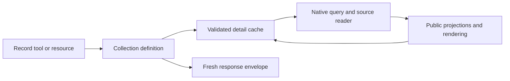

# Collection registry and application boundaries

The server exposes ten core collections through thirty-four tools: three record operations per collection and four shared discovery operations. Each core also has a readable Markdown resource and URI template. The registry makes this surface explicit without forcing every collection into an article-shaped record or exposing arbitrary Directus tables.

## Native records, shared discovery

`server/collections/index.ts` is the production allowlist. It registers articles, FAQs, sectors, testimonials, educational institutions, programs, regional education desks, podcast shows, podcast episodes and videos. Generating a source type or adding a supporting projection does not make a collection public.

Each definition owns its summary/detail schemas, supported inputs, source queries, normalization, search adapter and resource metadata. For example, FAQs use question/answer fields, programs have separately described forms, and episodes have show/season identity and transcripts. Native fields explain the data better than a common record with many invented empty properties.

The shared registry receives a narrower discovery view: identity, descriptions, capabilities, operation names, schemas, filters and facets. `list_collections` and `describe_collection` describe registered contracts; `get_filters` and `get_facets` dispatch only supported discovery operations. Unknown names and unavailable capabilities fail before provider access. A test-only FAQ definition exercises non-UUID identities and different record fields without entering the production allowlist.

Record tools remain explicit: `list_articles`, `get_article`, `search_articles`, and their equivalents for other collections. Their names select the collection, so they do not accept redundant collection selectors. Shared discovery tools do. Concrete tool files preserve individually advertised input/output schemas and domain guidance; a generic runtime router would obscure those contracts for little maintenance benefit.

Programs, educational institutions and regional education desks highlight geographic
search in their collection descriptions and search tool descriptions. Collection
descriptions flow through `list_collections`, `describe_collection` and resource
descriptions, so discovery includes instructions for `location`, optional `radius`,
nearest-first ranking and geographic response metadata. Tool descriptions distinguish
location text from the subject query and explain approximate service-area distances
for desks. See [geographic search](search.md#geographic-search) for the full contract.

## Responsibilities by layer

| Location                    | Responsibility                                                                                            |
| --------------------------- | --------------------------------------------------------------------------------------------------------- |
| `server/mcp/tools/`         | Static protocol declarations, meaningful descriptions and structured/text results with resource links     |
| `server/mcp/resources/`     | Explicit URI templates, native body selectors and metadata mapping                                        |
| `server/collections/`       | Domain-specific source queries, filters, schemas and normalization                                        |
| `server/utils/collections/` | Definition/envelope validation, registry metadata, source-read errors, detail caching and relation bounds |
| `server/utils/projections/` | Reusable public projections for people, assets, providers, locations, schedules, media and areas          |
| `server/utils/taxonomy/`    | Taxonomy identity/archives, source filter vocabulary and cached choices                                   |
| `server/utils/search/`      | Search transport, strict facet boundaries, snippets and result pagination                                 |
| `server/utils/content/`     | Pure content hydration/rendering, resource notices, media Markdown and YAML serialization                 |
| `server/utils/resources/`   | Pure descriptors, queued catalogue reads and protocol read/error handling                                 |

List and search operations use the same input/output boundaries but do not use the detail cache. Tools package data; they do not perform source queries or reimplement relationship rules. Resources call the same getter as tools and add their Markdown/YAML representation outside the record cache.

## Why the shared mechanisms stop here

`definition.ts` validates IDs and operation arguments, constructs portable output schemas and response envelopes, advertises capabilities and applies optional detail caching. `cache-detail.ts` stores only validated detail records. `read-records.ts` executes typed SDK commands and sanitizes source transport/validation failures. Queries remain at their collection call sites, where TypeScript checks selected fields against the generated schema.

Reusable projections remove repeated relationship handling without becoming generic public tables. Their output validators stay separate from source transforms because published MCP JSON Schema must describe the output, not executable parsing logic. Markdown formatting is separate again: a projection normalizes media identity; a content helper decides how a body and transcript appear in a resource.

This organization deliberately retains some explicit repetition: tool declarations, field selections, source-list filters and index mappings are useful review boundaries. Similar names do not imply identical source/index semantics. Introducing a query DSL, one configurable domain factory or automatic collection registration would weaken those boundaries. Splitting large domain modules into adjacent files can be useful when a domain grows independently; creating ten identical subdirectory trees now would add navigation without removing behavior.

## Resource boundaries

Resource infrastructure has three separate entry points. `resources/descriptors.ts` builds URIs and resource-link metadata without importing Directus, Nitro caching or the collection registry. Record tools depend only on this pure module. `resources/catalogue.ts` owns descriptor-only source queries, pagination, serialization and catalogue caching. `resources/read.ts` validates template IDs, calls an injected collection getter and translates failures into MCP errors.

Resource body composition lives in `content/`: program forms, sector guidance, desk consultation sections and media transcripts each have a focused formatter. These formatters accept only the fields they render; they do not import collection definitions or providers. Resource declarations bind a native collection getter to its formatter. The getter determines the document type, and selectors accept that type without narrowing or redefining the native detail contract.

Collection getters still render source body fields into Markdown because Markdown is also part of the JSON detail contract. Presentation-only resource headings, section layouts and missing-body notices are applied outside the record getter and its cache. Collection-owned `resourceMetadata` selectors remain alongside native schemas, where field exclusions can be reviewed when those schemas change.

Generic relation bounds live with `collectionRelationSchema` in `collections/relations.ts`. Shared projections use this infrastructure; navigator and media queries do not need to import editorial attribution just to bound a junction.

## Keeping changes local

Use these boundaries when extending the server:

- Change native schemas, selected source fields and normalization together in the collection module. Reuse a projection when multiple domains share the same relationship semantics.
- Keep source-list filters separate from index filters. Put provider transport and facet translation in `search/`; keep domain-specific hit mappings beside the collection.
- Add resource layout behavior to a pure `content/` formatter, then bind it in the resource declaration. A new layout should not require changing source access or cache code.
- Keep tools explicit and thin. Shared response packaging belongs in `tool-result.ts`; domain descriptions and advertised schemas remain visible in each tool.
- Keep cache durations in `config/cache.ts` and public visibility rules in Directus. Avoid embedding either policy in a formatter or projection.

The larger collection modules combine closely related schemas, typed queries and domain normalization. Split a module when one of those responsibilities gains an independent lifecycle or becomes difficult to navigate; line count alone is not a reason to create identical directory trees. Search transport, validation and facet behavior already form one adapter boundary; an additional provider abstraction becomes useful only when a second provider is required.

See the [testing guide](../tests/README.md) for the appropriate validation boundary. Pure descriptor tests require no provider/runtime mocks; native contract tests and HTTP tests protect the wiring between the separate layers.

See [collection data](collection-data.md) for relationship semantics, [search](search.md) for index discovery and geographic search, [resources](collection-resources.md) for representations and [caching](cache.md) for freshness boundaries. Directus visibility remains governed by [data access responsibilities](data-access.md). Regional desk geographic searches approximate coverage using indexed grid points; exact polygon matching remains unavailable.
